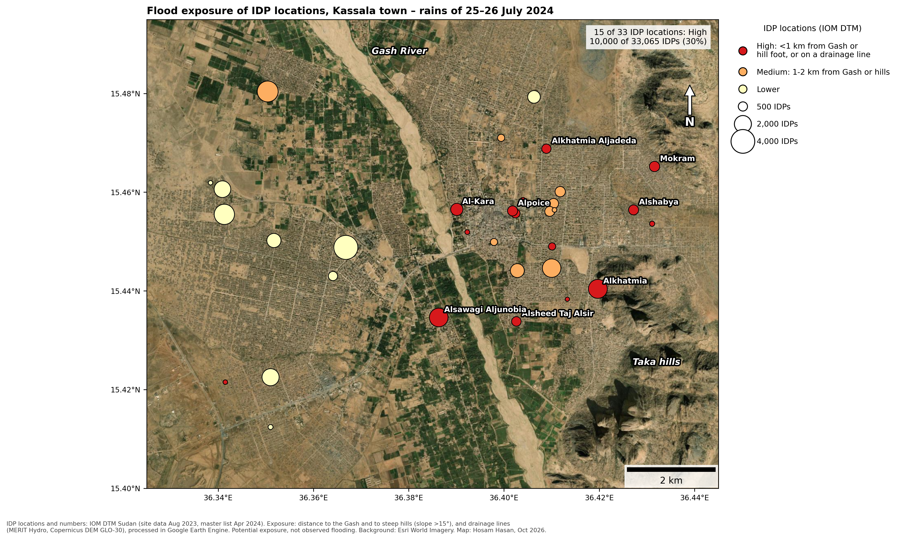

# Flood exposure of displaced people in Kassala, Sudan – July 2024 rains

*Self-directed project · Google Earth Engine · Python · October 2026 · Hosam Hasan Abdalla*

On 25–26 July 2024 heavy rain fell on Kassala in eastern Sudan: 118 mm in Kassala town, 95 mm at Wad Sherifey and 74 mm in Gharb Kassala, according to OCHA. About 10,000 people were affected, most of them people who had just fled fighting in Sennar State. Their tents, latrines and the roads around them flooded.

I wanted to know which places where displaced people live in Kassala are most exposed to this kind of flooding.

First I tried to map the floodwater with Sentinel-1 radar, using the change-detection method from my [White Nile project](https://github.com/hosam-hasan1/white-nile-flood-2020). A fixed dark-pixel threshold failed: dry sand around Kassala is as dark as water on radar, so the "water" area peaked in the dry month of June. Comparing each 2024 image with the same dates in 2017–2023 fixed that. Still, the first image after the rain (5 August, ten days later) showed no standing water at any displacement location. Rainwater in town drains or dries within days, and radar cannot see water between buildings.

So I measured exposure instead of observed flooding. For 48 displacement locations from the IOM Displacement Tracking Matrix, I calculated the distance to the Gash River, the distance to the foot of steep hills (the Taka mountains, slope above 15°), whether the location sits on a drainage line, and the rainfall from two satellite products. A location is rated High if it is within 1 km of the Gash or of a hill foot, or on a drainage line; Medium if it is 1–2 km from either; Lower otherwise.

In Kassala town, 15 of 33 locations were rated High, holding about 10,000 of 33,000 displaced people (30%). The largest are Al-Khatmiyya (2,500 people, 175 m from the hill foot), Al-Sawagi Al-Janubiya (2,430, 790 m from the Gash) and Al-Kara (990, 450 m from the Gash). All 11 locations in New Halfa were rated Lower.

**Limits.** This is potential exposure, not observed damage. The IOM locations date from August 2023, before the people from Sennar arrived; the July 2024 gathering sites are not named in public reports. Elevation differences between locations were below the accuracy of the 30 m elevation model, which also includes buildings, so I did not use them. Satellite rainfall was 4–5 times lower than the station figure (20–31 mm against 118 mm), so it shows where rain fell, not how much. The 1 km and 2 km thresholds are my own choice. Nothing has been checked on the ground.

**Next steps.** Map the July 2024 gathering sites from high-resolution imagery taken in September 2024, and apply the same method to refugee camps in White Nile State.

## Results

All 46 IOM locations with valid coordinates (two locations with coordinates far from town were excluded):

| Class | Locations | Displaced people |
|---|---|---|
| High | 16 | 10,325 |
| Medium | 9 | 9,190 |
| Lower | 21 | 36,605 |

Rainfall 24–28 July 2024 (satellite) vs station:

| Locality | CHIRPS | GPM IMERG | Station (OCHA) |
|---|---|---|---|
| Kassala town | 20–23 mm | 25–31 mm | 118 mm |
| New Halfa | 10–22 mm | 16–19 mm | – |
| Shamal Ad Delta | 26–32 mm | 41–49 mm | – |

## Repository contents

| File | What it is |
|---|---|
| `01_find_flood_date_sentinel1.js` | Earth Engine: new water in every 2024 Sentinel-1 image vs a normal year (same dates, same track) |
| `02_idp_exposure.js` | Earth Engine: distance to the Gash and hills, drainage lines and rainfall at each IOM location; CSV export |
| `make_idp_exposure_map.py` | Python (Google Colab): classification, map and ranked table |
| `IDP_exposure_Kassala_2024_v2.csv` | Exported values per location |
| `Map_Kassala_IDP_exposure_2024.png` | Final map, 300 dpi |
## How to reproduce

1. Paste `02_idp_exposure.js` into the [Earth Engine Code Editor](https://code.earthengine.google.com) and click Run.
2. In the Tasks tab, run the export. The CSV goes to the Google Drive folder `ProjectB_GEE`.
3. In Google Colab, install `contextily` and `matplotlib-scalebar`, mount Google Drive and run `make_idp_exposure_map.py`.

## Data

- IOM Displacement Tracking Matrix, Sudan IDP Master List (25 April 2024; Kassala site data 16 August 2023). Latitude and longitude columns were swapped in the source file and are corrected here.
- Copernicus Sentinel-1 GRD (ESA), via Google Earth Engine
- Copernicus DEM GLO-30; MERIT Hydro (upstream area)
- CHIRPS daily rainfall; NASA GPM IMERG V07
- JRC Global Surface Water (permanent water)
- OCHA Sudan Flash Update No. 1 (28 July 2024) and No. 2 (2 August 2024)
- Map background: Esri World Imagery

Contains modified Copernicus Sentinel data (2024).
